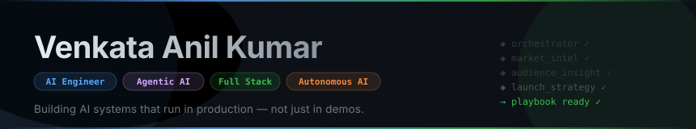

 

---

I design and build AI systems that actually work in production. My focus is on the hard parts — agentic reasoning, reliable orchestration, and full-stack execution — because good ideas only matter when they survive contact with real users and real scale.

---

## Currently Building

**[NortPole](https://github.com/VenkataAnilKumar/NortPole)** — Governed AI workspace that answers questions and runs multi-step work over a company's own knowledge, with cited results. You approve the plan before work runs and the exact draft before anything leaves, and every action lands in a tamper-evident audit log. *Pilot preview.*

**[NorthWritX](https://github.com/VenkataAnilKumar/NorthWritX)** — Legal workspace for Canadian law firms and in-house teams that brings matter files, source previews, and reusable AI review workflows together across web and desktop. *Development preview.*

**[NorthCX](https://github.com/VenkataAnilKumar/NorthCX)** — Open-source, self-hosted platform for AI agents that resolve customer issues end to end, on local and cloud models. Risky actions wait for human approval, and changes are tested before customers see them. *Release candidate.*

**[ALIV](https://github.com/VenkataAnilKumar/ALIV)** — Audited Local Intelligence Vault that gives legal and finance teams cited answers over client documents kept on their own machines. Local by default, cloud only when a matter's policy allows it, with a tamper-evident audit log. Built with Rust, Tauri, and React. *Pre-release.*

---

## Core Expertise

- **Agentic AI** — designing agents that reason, use tools, and act autonomously with human oversight
- **AI Backend** — building the APIs, pipelines, and infrastructure that make AI products reliable in production
- **AI Full Stack Product** — owning the full product: backend, frontend, mobile, and the AI layer
- **Forward Deployed Engineering** — working directly with customers to scope, build, and ship AI solutions fast

---

## Skills

**AI & Agents**

**Backend**

**Frontend**

**Infrastructure**

---

## Open To

Applied AI Engineer, Applied AI Solution Architect, Agentic AI Engineer, AI Forward Deployed Engineer (FDE), AI Engineer, and Autonomous Systems Engineer roles — remote or on-site.

vanilkumarch@gmail.com · linkedin.com/in/venkataanilkumar

